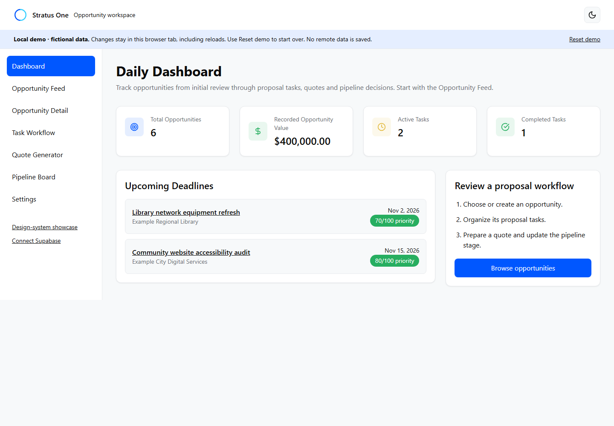

# Stratus One

Stratus One is a React/TypeScript opportunity-workflow application for reviewing opportunities, managing proposal tasks, creating quote estimates, and tracking pipeline stages.

The default demo runs without an account or Supabase credentials. The same application screens support a separately provisioned Supabase backend. Hosted end-to-end verification is currently pending.

## Screenshots



[Opportunity detail](docs/screenshots/detail.png) · [Task workflow](docs/screenshots/taskpack.png) · [Quote generator](docs/screenshots/quotegen.png) · [Pipeline](docs/screenshots/pipeline.png)

## Features

- Opportunity creation, search, status filtering, pagination, and detail views.
- Proposal task packs with task creation, completion, and reopening.
- Quote estimates with line items, tax, saved versions, stale-write detection, and browser printing.
- Six-stage opportunity pipeline, display-profile settings, and theme selection.
- Shared desktop/mobile navigation with selected-opportunity deep links and Back/Forward support.

Typical workflow: Dashboard → Opportunity Feed → opportunity detail → Task Workflow → Quote Generator → Pipeline Board.

## Architecture

```text
User
 ↓
React / TypeScript application
 ↓
typed service boundary
 ├─ demo adapter → fixtures/sessionStorage
 └─ Supabase adapter → Auth/PostgreSQL/Edge Functions
```

`src/components/screens/` contains the shared application screens. `Stratus*` and `components/ui/` supply reusable UI primitives; `src/showcase/` contains the separate gallery. Typed service facades select `src/demo/` or `src/services/supabase/`. Supabase initialization is lazy and is not required by demo mode.

`src/domain/` shares quote calculations, validation, and deterministic priority scoring. Migrations define ownership policies, relationship constraints, and authoritative quote/task triggers. Database types are generated from committed migrations, with drift detection in CI. See [backend documentation](docs/BACKEND.md).

## Stack

React 18, strict TypeScript, Vite, Tailwind CSS, Radix UI, Supabase JS, Deno, Vitest/Testing Library, PGlite, and Playwright.

## Running locally

Install Node.js 24 LTS with npm, then run:

```sh
npm ci
npm run dev
```

Open the URL printed by Vite, normally `http://localhost:3000`. If `node` or `npm` is not recognized, install Node.js and reopen the terminal.

## Application modes

| Mode | URL | Behavior |
| --- | --- | --- |
| Demo (default) | `/` or `/?mode=demo` | Fictional fixtures, no credentials or backend requests. Saved changes use this tab's sessionStorage; no network persistence. |
| Showcase | `/?mode=showcase` | Component/design-system gallery with illustrative UI, not product integrations. |
| Supabase application | `/?mode=app` | Real backend implementation requiring separate provisioning. Authenticated records persist in PostgreSQL under owner RLS. Hosted E2E verification is pending. |

Demo saves survive reloads. **Reset demo** restores the initial fixtures after confirmation. Browser session restoration may retain sessionStorage; reset is the reliable fresh start. When storage is blocked, the banner explains that changes last only until reload. Unsaved form/quote edits are discarded when leaving a screen. Theme preference uses localStorage across modes.

## Supabase setup

Provision a separate project using [BACKEND.md](docs/BACKEND.md), copy `.env.example` to `.env.local`, configure the following, and restart Vite:

```dotenv
VITE_SUPABASE_URL=https://your-project.supabase.co
VITE_SUPABASE_ANON_KEY=your-publishable-or-legacy-anon-key
```

These are public browser settings. Never use secret or service-role keys. Demo identities cannot authorize hosted requests. Missing configuration displays setup guidance and a link to demo mode.

## Testing

```sh
npm run check                 # lint, strict types, unit/component/schema tests, build
npm run db:types:check        # migration/type drift
npx playwright install chromium
npm run test:e2e              # Chromium application workflows, desktop and mobile
npm audit --audit-level=moderate
```

Demo tests exercise local services and check for backend requests. Hosted-mode browser tests use explicit API fixtures. PGlite executes the real migration and checks ownership isolation, constraints, and triggers. These tests do not substitute for hosted Auth, PostgREST, or deployed Edge Function verification.

## CI

[GitHub Actions](.github/workflows/ci.yml) runs clean installation, lint, strict TypeScript, generated-type drift checks, unit/component/database tests, browser tests, production build, dependency audit, and Deno checks for both Edge Function entry points.

## Limitations

- Hosted deployment and full integration verification are pending; no production deployment is claimed.
- Demo storage is disposable and does not emulate every PostgreSQL or Auth behavior.
- Priority scoring is a transparent heuristic, not a win probability.
- Quotes are estimates; PDF output uses browser printing, not a server generation service.
- Automated ingestion, email/reminder delivery, daily planning, account administration, external integrations, and unsaved-draft autosave are not implemented.
- Some retained UI/tooling dependencies have deprecation notices (ESLint 9, Recharts 2, and transitive whatwg-encoding); dependency auditing runs in CI.

## Attribution

The visual foundation originated from a Figma component-library export and was subsequently refactored into application architecture. Original provenance and third-party attribution are preserved in [Attributions](src/Attributions.md).
